<div align="center">

# Forecasting 30-day customer GMV


**Ozon E-CUP 2026 / Task 3 / Team ICEQ**


</div>

For each of 250,000 Ozon customers, we predict how much they will spend in Search and
Catalog between 2026-02-14 and 2026-03-15. The input is 409 days of daily activity, 30.6 M
rows in total, and the metric is RMSLE.

Our team finished in the top 4 of the private leaderboard. The final submission stacks 26
components: daily generative networks, event-time RNNs, gradient boosting and probabilistic
models. A nine-step calibration ladder sits on top of the stack. We measured the size of
each step with a public leaderboard submission and shrank it for noise. The code in this
repository rebuilds the final submission from `train.parquet`.

<div align="center">

| | Public RMSLE |
|---|---:|
| Organizers' naive baseline (`prev30` as is) | 2.19506 |
| Daily generative network, 4 bagged members (best neural vector) | 1.65179 |
| Stack of 9 models, day 2 | 1.64918 |
| Stack solved from leaderboard scores, 26 components (`stack_v12`) | 1.64600 |
| **Final submission: stack plus the 9-step calibration ladder (`stack_v23_dir`)** | **1.6452202** |

</div>

The final forecast explains 49.56% of the variance of `log1p(GMV)` (the naive baseline
explains 10.22%) and correlates with the target at 0.7040.

---

## Contents

1. [Key ideas](#key-ideas)
2. [What the data says](#what-the-data-says)
3. [Solution architecture](#solution-architecture)
4. [Models](#models)
5. [Stacking and calibration from leaderboard submissions](#stacking-and-calibration-from-leaderboard-submissions)
6. [Results](#results)
7. [What did not work](#what-did-not-work)
8. [Repository layout](#repository-layout)

---

## Key ideas

1. **RMSLE is minimised by the conditional mean of `log1p(Y)`.** The optimal answer is
   `expm1(E[log1p Y | x])`. Summing expected daily GMV and taking the log afterwards costs
   1.09 in log space through the Jensen gap, and the same model scores 2.48051 instead of
   1.75495.
2. **The customers were selected by activity.** All 250,000 customers are active in each of
   the last three 30-day blocks (exactly 100.0000%), and in the fourth block the share drops
   to 93.3%. So the local validation window is the selection window. It also falls on the
   only seasonal dip of the year, and a calibration fitted on it made the leaderboard score
   worse.
3. **The strongest model predicts the daily path and sums it inside the logarithm.** For each
   of the 30 days it predicts a purchase hazard and a spend distribution. A per-customer
   frailty term makes the days dependent.
4. **An exact readout gave the largest single gain.** We first computed the expected log-sum
   by simulating 96 paths per customer. An exact quadrature (Frullani identity plus
   Gauss-Hermite) removed 1.65·10⁻³ RMSLE of Monte-Carlo noise, eight times the gain of the
   best new external signal.
5. **A threshold ladder is the best single vector.** Thirty-three binary LightGBMs for
   `P(log1p Y > s)`, integrated over `s`, give `E[log1p Y]` with no distributional
   assumption. The ladder scored 1.73556 on local validation, ahead of every network.
6. **We solved the stack from leaderboard scores.** A vector's public RMSLE fixes its
   covariance with the hidden truth exactly, so blend optimisation becomes linear algebra.
   We predicted blend scores before submitting them, with errors as small as 2.8·10⁻⁶.
7. **Calibration is a ladder of measured, shrunk steps.** Each of the nine steps moves the
   forecast along one direction. One leaderboard submission measures the strength of that
   direction, and we shrink it by `κ = max(0, 1 - 1/t²)`. After the overfitting penalty,
   the expected private gain is +7.2·10⁻⁴.

---

## What the data says

We measured all target statistics below on a local anchor (2026-01-14, 30-day horizon),
which replicates the competition setup. The real target window is not in the training data.

### 45.9% of customers buy nothing

<picture>
  <source media="(prefers-color-scheme: dark)" srcset="docs/figures/01_target-dark.svg">
  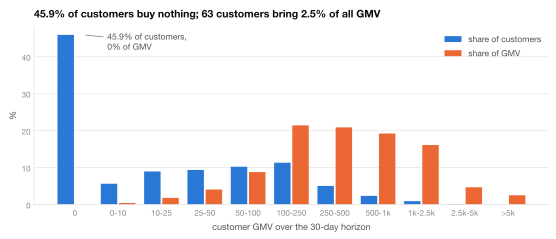
</picture>

45.9% of customers spend exactly zero in the horizon. At the other end, 63 customers
(0.025%) bring 2.5% of all GMV. So the prediction head needs a gate for zero vs. non-zero
and a separate distribution for the amount.

<picture>
  <source media="(prefers-color-scheme: dark)" srcset="docs/figures/02_lorenz-dark.svg">
  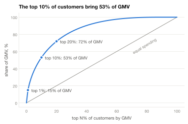
</picture>

### The validation window falls on the only dip of the year

<picture>
  <source media="(prefers-color-scheme: dark)" srcset="docs/figures/03_daily-dark.svg">
  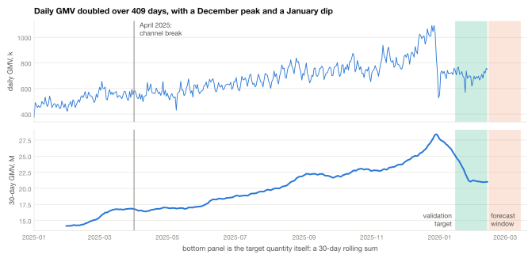
</picture>

GMV roughly doubles over the year, peaks in December and dips in January. The local
validation target (green) is that January dip. An affine correction fitted on it and applied
to the final anchor made the score worse by 0.0067, and six independent checks gave the same
result. After that we used local validation only to rank ideas.

In April 2025 the channels split. The catalog's share of orders fell from 0.080 to 0.058 in
one month, and the catalog's average order value rose from 37.4 to 44.9. Training windows
longer than eleven months mix in the pre-April catalog.

### Buyers grew, baskets shrank

<picture>
  <source media="(prefers-color-scheme: dark)" srcset="docs/figures/04_growth-dark.svg">
  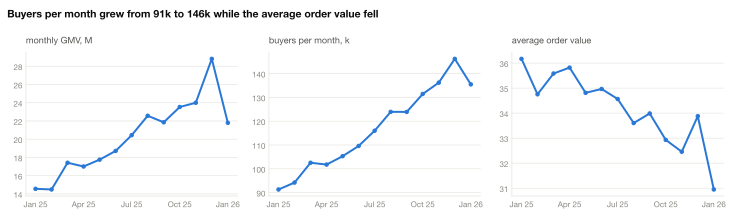
</picture>

Monthly GMV grew from 14.6 M to 28.8 M and monthly buyers from 91 k to 146 k, while the
average order value fell from 36.2 to 31. The customer selection described below explains
part of this growth.

### The customers were selected by activity

<picture>
  <source media="(prefers-color-scheme: dark)" srcset="docs/figures/07_blocks-dark.svg">
  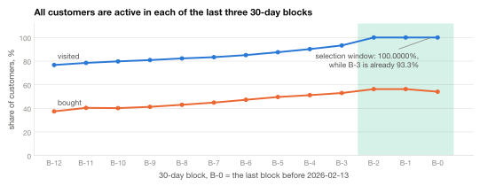
</picture>

Every one of the 250,000 customers is active in each of the last three 30-day blocks.
Before that, the share falls block by block: 93.26%, 90.2% and lower. A natural population
would not produce this cliff, and it has three consequences.

1. The growth trend is partly an artefact, because the sample gets denser towards the end of
   the history by construction.
2. Validation on the last window is optimistic. Its target window is the selection window,
   so 100% of customers are active in it.
3. We measured that optimism. Replaying the selection rule on earlier anchors, whose target
   windows are free of it, gives 97.2-98.0% activity instead of 100%, and the RMSLE level
   stays stable across anchors. The local anchor is usable for ranking, and the test should
   have 2-3 percentage points more zeros.

### Recency and the ceiling of aggregates

<picture>
  <source media="(prefers-color-scheme: dark)" srcset="docs/figures/05_recency-dark.svg">
  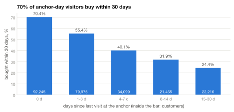
</picture>

A customer who visited on the anchor day buys within the horizon with probability 70.4%.
After two to four weeks of absence, the probability is 24.4%. The number of days with a
purchase over the whole history correlates with the target at 0.630, more than GMV over
90 days (0.589) or over 30 days (0.557).

<picture>
  <source media="(prefers-color-scheme: dark)" srcset="docs/figures/08_baselines-dark.svg">
  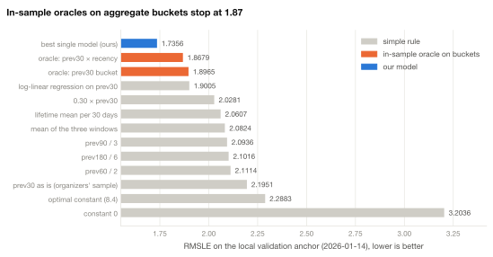
</picture>

The oracles in this chart split customers into `prev30 × recency` buckets and plug in the
best possible value for each bucket, in-sample. They still stop at 1.868. Low-dimensional
aggregates cannot solve the task, and all the remaining headroom is in modelling each
customer individually.

<details>
<summary>More: transition matrix and weekly rhythm</summary>

<picture>
  <source media="(prefers-color-scheme: dark)" srcset="docs/figures/06_transition-dark.svg">
  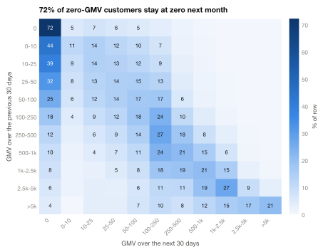
</picture>

72% of customers with zero GMV in the previous month stay at zero, yet one in eight
customers who bought nothing in 409 days buys next month. This segment is the hardest to
predict.

<picture>
  <source media="(prefers-color-scheme: dark)" srcset="docs/figures/10_dow-dark.svg">
  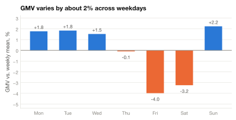
</picture>

The weekly rhythm is real but only ±2%, and a 30-day sum spans 4.3 weeks. A submission that
aligned predictions to the day of week measured `t = +0.60`, so the effect on the target is
zero.

</details>

---

## Solution architecture

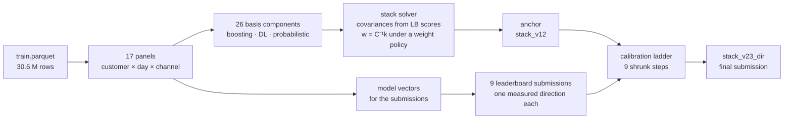

Only the anchor (`stack_v12`) is a blend. Each step above it moves the forecast along one
direction, measured with its own leaderboard submission and shrunk according to how reliable
that measurement was.

---

## Models

The stack basis has 26 components from six families:

| Family | Members |
|---|---|
| Daily generative networks | dilated-CNN trunk with per-day hazard and amount heads; bagged; fusion with patch attention |
| Event-time RNNs | GRU ensembles over the last 32, 96 and 182 active days |
| Sequence hybrids | TFT-style variable selection, static enrichment, N-BEATS residual stacking |
| Gradient boosting | CatBoost, LightGBM (including DART) and XGBoost on a 165-column feature store; RFE subsets |
| Two-stage and probabilistic | "will buy" × "how much", BTYD (buy-till-you-die) models |
| Tabular networks and others | FT-Transformer, TabNet, CoLES contrastive encoder, kNN, elastic net |

Half of the neural vectors enter the stack with negative weights. The stack uses them to
cancel errors that they share with other components.

### Daily generative network

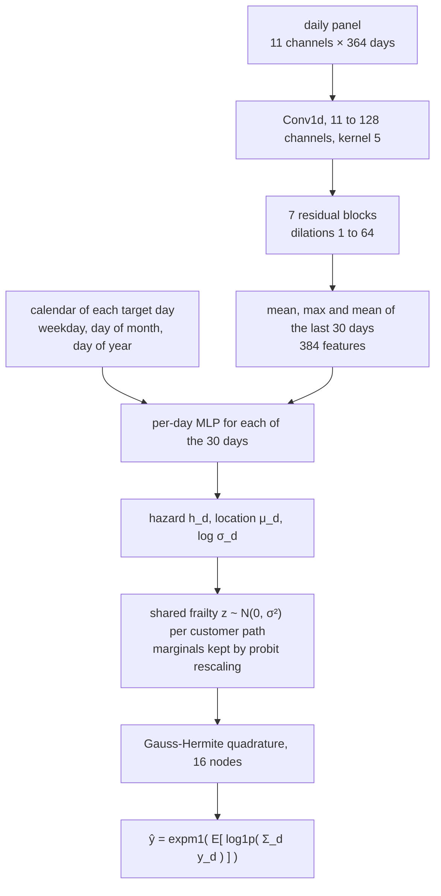

The model uses none of the 165 tabular features, only the raw daily series and the calendar
of the target days. It needs three ingredients, and removing any one of them breaks it:

- a gate (a diffusion head without one predicts `P(Y>0) = 1.0000`);
- an amount distribution;
- dependence between days (with an independent gate, `P(Y>0)` comes out at 0.9822).

A single latent frailty per customer path provides the dependence. We fitted its scale
(σ = 0.8) once to the observed `P(Y>0) = 0.5427` and froze it.

### Exact readout instead of sampling

We first read every daily generative model out by simulating 96 paths per customer. That
estimate is unbiased but noisy, and the noise adds to MSE in full: if `ŷ = θ + ε`, then
`MSE = MSE_true + Var(ε)`. Given the frailty, the days are independent, so the Frullani
identity gives the expected log-sum exactly:

$$
\mathbb{E}\big[\log(1+S)\big] \;=\; \int_0^\infty \frac{e^{-t}}{t}\,\big(1-\mathcal{L}_S(t)\big)\,dt
$$

The Laplace transform $\mathcal{L}_S$ factorises over days, and the same Gauss-Hermite nodes
integrate out the frailty.

<picture>
  <source media="(prefers-color-scheme: dark)" srcset="docs/figures/12_readout-dark.svg">
  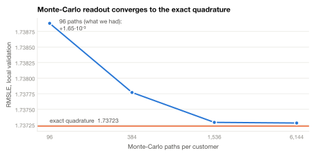
</picture>

`sd(MC - quadrature)` falls as `1/√n`: the ratios between successive path counts are 2.005,
2.001 and 1.992 against a theoretical 2.000. The quadrature computes the limit of the
simulation exactly.

### Event-time models

These models index events instead of calendar days: the last K active days, with 12
features per event (GMV, searches, carts, orders, gap since the previous event, recency,
weekday, channels). Three GRUs with memories of 32, 96 and 182 events beat a single LSTM by
0.005, six times the 0.00084 that an LSTM gains over a GRU. Memory horizon mattered more than
gate design.

### Threshold ladder

$$
\mathbb{E}[S\mid x] \;=\; \int_0^\infty P(S>s\mid x)\,ds \;\approx\; \sum_m h_m(x)\,\Delta,\qquad S=\log(1+Y)
$$

Each `h_m` is a binary LightGBM classifier for `log1p Y > s_m`, with 33 thresholds spaced
0.25 apart. The lowest rung gives the zero mass. This readout scores 1.73556 on local
validation, ahead of the CNN (1.73808) and boosting (1.73831). Reading the same classifiers
at the median gives 1.89937, so the median is the wrong functional for this metric.

<details>
<summary>Late-stage architectures: ConvViT and WavLM (not in the final submission)</summary>

- **ConvViT** folds the 364-day series into a weeks × weekday matrix. A convolutional stem
  captures local structure and attention blocks capture long-range links. A positional hint
  for the week index helps only this architecture (`t = -2.85`, `p = 0.047` over five paired
  seeds). Its contribution to the stack residual is -1.56·10⁻³.
- **WavLM** is a speech-recognition architecture that we applied to the daily series:
  masked denoising with example mixing, a convolutional feature encoder and a transformer
  with gated relative position bias. Its contribution is -1.37·10⁻³, 1.5 times better than a
  plain ViT.

</details>

---

## Stacking and calibration from leaderboard submissions

### Two measured constants and one identity

`RMSLE²` as a function of a constant log-shift is an exact parabola, so three shifted
submissions give `E[log1p Y] = 2.3284`. One slope submission gives
`Var(log1p Y) = 5.366802`. With these two constants, the public score `R_j` of any submitted
vector `P_j` fixes its second moment with the hidden truth `L` exactly, because the truth
cancels:

$$
k_j \;=\; \mathbb{E}[L\,P_j] \;=\; \tfrac12\big(\mathbb{E}[L^2] + \mathbb{E}[P_j^2] - R_j^2\big),
\qquad
R^2(w) \;=\; \mathbb{E}[L^2] - 2\,w^\top k + w^\top C\,w
$$

So we knew the score of any linear blend before submitting it. Prediction errors fell from
2.9·10⁻⁵ and 1.0·10⁻⁴ early in the project to 2.8·10⁻⁶.

### The stack solver

The unconstrained optimum `w = C⁻¹k` degenerates because the components correlate at 0.99
and above. Two corrections fix it, and each one came from a failed submission:

- **Registry correction of `k`.** Every blend we had already measured gives an exact linear
  constraint on the error of `k`, and we subtract the min-norm correction.
- **Weight policy.** We cap `max|w|` at 0.6 and allow no weight below -0.25. A blend that
  broke this policy missed its predicted score by 0.0016.

### The calibration ladder

Each step adds one direction `D` to the previous step. The direction comes from a
leaderboard submission that spends one slot. We derive the strength `θ` from that
submission's score and apply it with per-coordinate shrinkage:

```
eps   = sqrt((R0 + 0.0015)² - R0²)      cost of one submission in metric units
null  = sqrt(R0² + eps²)                submission score if the direction has no effect
theta = (null² - measured²) / (2·eps)
t     = theta / SE,   SE = R0 / sqrt(50 000)
kappa = max(0, 1 - 1/t²)
step  = previous + kappa · theta · D,  re-levelled to E[log1p Y] = 2.3284
```

<picture>
  <source media="(prefers-color-scheme: dark)" srcset="docs/figures/09_ladder-dark.svg">
  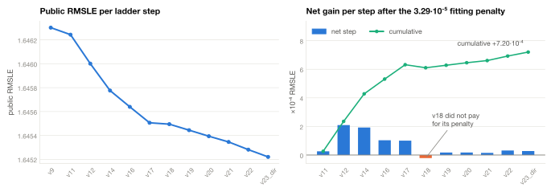
</picture>

| Step | Direction measured by the submission | θ | κ (share applied) |
|---|---|---:|---:|
| v12 to v14 | joint direction from 82 click-activity contrasts | -0.0255 | 0.92 |
| v14 to v16 | the same window one year earlier | +0.0215 | 0.88 |
| v16 to v17 | cross-customer rank trajectory | +0.0182 | 0.84 |
| v17 to v18 | customer cohort | -0.0087 | 0.29 |
| v18 to v19 | quantile heads (two arms, averaged) | +0.0136 | 0.71 |
| v19 to v20 | exact quadrature vs. 96-path Monte Carlo | +0.0135 | 0.70 |
| v20 to v21 | variable selection with sigmoid gates vs. softmax | -0.0130 | 0.68 |
| v21 to v22 | transformer vs. recurrent operator | -0.0149 | 0.76 |
| v22 to v23_dir | weight drift over time | -0.0131 | 0.69 |

The ladder gains 1.082·10⁻³ on the public board. The expected public-to-private penalty is
3.29·10⁻⁵ per fitted parameter, which we checked with 200,000 Monte-Carlo replicates, so the
expected private gain is +7.20·10⁻⁴.

The gain of a step follows a closed formula, `θ²·κ(2-κ)/(2R)`. For the year-earlier
direction it predicts 1.384·10⁻⁴, and the measured gain was 1.38·10⁻⁴. We derived the
shrinkage rule from this formula.

Rules we followed when building the submissions:

- Submit the difference between two versions of a model, which contains only what changed.
- Take both halves of a pair from the same run of the same script. Runs of different
  scripts differ by a systematic shift of about 0.002.
- Average correlated differences into one axis.
- Ignore the sign, because the gain depends on `θ²`.
- Take the step size from the measured score. A ridge-estimated weight once overshot `θ` by
  a factor of 4.6.

---

## Results

<picture>
  <source media="(prefers-color-scheme: dark)" srcset="docs/figures/11_lb_progress-dark.svg">
  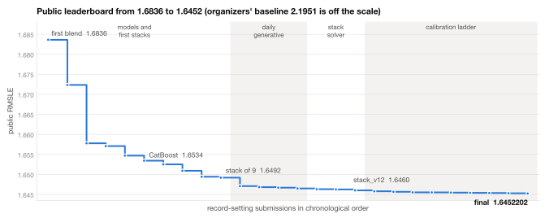
</picture>

| Milestone | Public RMSLE |
|---|---:|
| First blend | 1.68362 |
| CatBoost, level set analytically | 1.65343 |
| Stack of 9 vectors | 1.64918 |
| Daily generative network added to the stack | 1.64706 |
| Stack solved from leaderboard scores (`stack_v12`) | 1.64600 |
| **Calibration ladder top (`stack_v23_dir`)** | **1.6452202** |
| **Private leaderboard** | **top-4** |

### Business view

We measured these numbers on a held-out month with a known outcome (2025-12-16 to
2026-01-14), using a model of the same class as the submission (RMSLE 1.741 on that window).

| | |
|---|---|
| 43.7% | of next-month GMV is held by the top 10% of customers by forecast, 4.4 times the share of a random 10% |
| 0.849 | ROC AUC for buy vs. no buy; ranking by last month's GMV gives 0.772 |
| 48.8% | of buyers fall into the top 30% by forecast |

<picture>
  <source media="(prefers-color-scheme: dark)" srcset="docs/figures/13_gain-dark.svg">
  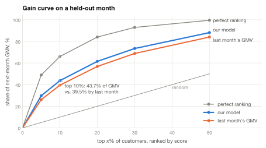
</picture>

---

## What did not work

We explored 15 directions and closed each one with a controlled measurement.

| Direction | Ideas tested | Paid off | Verdict |
|---|:---:|:---:|---|
| External axes and leaderboard submissions | 10/10 | 9/10 | nine early axes, four strong, S/N up to 13.2 |
| Readout and functionals | 10/10 | 10/10 | exact quadrature for the daily models; threshold ladder |
| Daily generative models | 10/10 | 9/10 | strongest component; daily supervision helps, a daily decomposition of the prediction does not |
| Stacking and weights | 10/10 | 8/10 | 12 constraints; bit-identical duplicates found in the basis |
| Gradient boosting | 10/10 | 8/10 | backbone of the solution; 15 objective functions tried |
| Features | 10/10 | 7/10 | decays and zero structure: 220 new columns carry almost as much as the old feature store |
| Event-time models | 10/10 | 5/10 | the multi-horizon ensemble passed; LSTM flipped sign in the ensemble |
| Contrastive learning | 8/10 | 4/10 | CoLES +0.047; its global pretext task fits a local problem poorly |
| Encoders and attention | 10/10 | 3/10 | gains come from the input representation |
| Training axis | 10/10 | 0/10 | anchors, weighting, penalty shape: shared axis `t = -0.57` |
| Noise and averaging | 10/10 | 0/10 | seed averaging refuted twice; TTA within seed noise |
| Rhythm and calendar | 9/10 | 0/10 | the weekly rhythm is real, but its estimate has reliability 0.085 |
| Foundation models | 10/10 | 0/10 | two families, five sizes, three modes, all against controls |
| Segmentation and clusters | 9/10 | 0/10 | five submissions and three screens, all zero |
| Target decomposition | 9/10 | 0/10 | clicks × conversion, channels, ratio, churn, holidays |

<details>
<summary>Selected closed experiments</summary>

| Idea | Result |
|---|---|
| Chronos-2, three modes | 1.883, 1.920 and 1.904 against 1.748 for the control |
| Toto 2.0 zero-shot | 1.958 against 1.724; `P(Y>0)` 0.997 against the true 0.583 |
| Moirai-1.1-R-large as a trunk | loses to the control by +0.00834 |
| Conditional diffusion (TSDiff-style) | 1.81944 with a gate against 1.73808 |
| Training directly on the metric through the quadrature | +4.09·10⁻³; the daily likelihood gives 30 times more supervision |
| Channel decomposition (two stacks or two heads) | 2.48 against 1.77 for the direct model |
| Separate churn model | AUC 0.851, but zeroing out adds about 0 |
| kNN as a stack component | most orthogonal vector of the project (0.980), but 0.025 behind |
| Transformer over events | better score (-0.00245) and no orthogonality at all |
| FiLM conditioning of the conv trunk | breaks it: 2.02 against 1.744 |
| User-user graph, latent factors | +0.00037 inside a ±0.0004 noise band |
| Activity base rate in the context | +1.24·10⁻³ locally on six trunks, zero on the leaderboard |
| SARIMA, intermittent-demand classics | 95% zeros break the assumptions; 1.8405 |
| Isotonic recalibration of the threshold ladder | perfect calibration, score worse by 3.3·10⁻⁴ |

The technical report in [docs/technical_report_ru.md](docs/technical_report_ru.md) (in
Russian) has the full list with all numbers.

</details>

---

## Repository layout

```
.
├── solution/                    the final submission, end to end
│   ├── run.py                   builds stack_v23_dir.csv from train.parquet
│   ├── components/
│   │   ├── common.py            panels, feature store, validation protocol
│   │   ├── *.py                 shared modules: btyd_lib, features_v2, extra_features, zoo_common
│   │   ├── panels/              17 dense customer × day panels
│   │   ├── basis/               21 scripts for the 26 basis components of the stack
│   │   ├── models/              8 scripts for the model vectors used in the submissions
│   │   ├── probes/              constructions of the ladder submissions, build_probe.py
│   │   └── stack/               stack solver
│   ├── data/                    leaderboard scores, training plans, ladder spec
│   └── vectors/                 cached prediction vectors for run.py --cached
├── eda/                         exploratory analysis and the figure generator
├── docs/
│   ├── technical_report_ru.md   full technical write-up (in Russian)
│   └── figures/                 figures used in this README, light and dark
└── requirements.txt
```

---

<div align="center">
<sub>Thanks to Ozon Tech for organising the competition.</sub>
</div>
