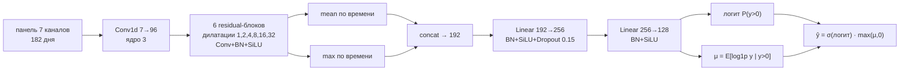
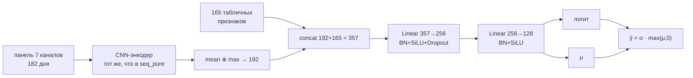
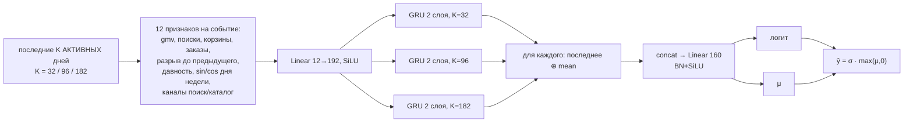
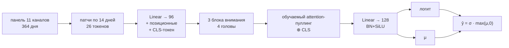
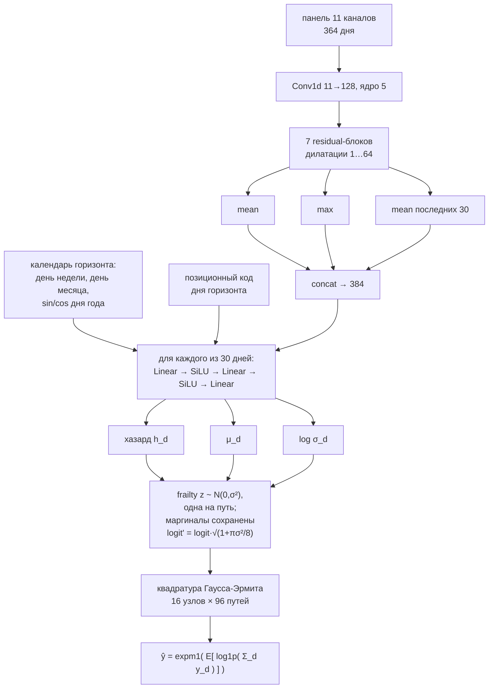
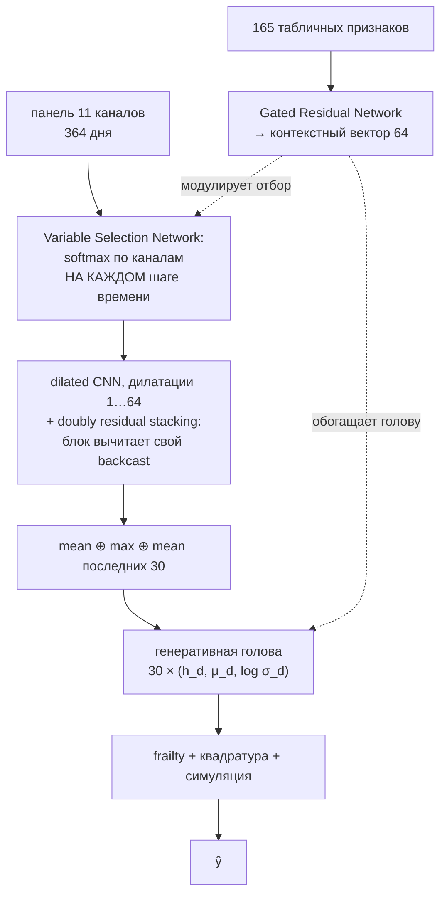

# DL-стек: что там внутри и где узкое место

Восемь нейросетевых векторов в решении. Ниже — точные архитектуры по коду, их вклад в стек
и разбор того, что оказалось важным, а что — нет. Раздел про энкодеры переписан: первая версия
содержала диагноз, который последующие эксперименты **опровергли**, и это разобрано ниже.

Лучший вектор команды — **1,6457758**. Прогресс от топ-1 на момент передачи: −0,0023.

## Вклад в стек

| компонента | LB | corr(L) | что это |
|---|---|---|---|
| **daily_bag** | 1,6517936 | 0,70115 | дневная генеративная, 4 члена по 80% |
| **tft_all** | 1,6526141 | 0,70079 | + VSN, статическое обогащение, residual stacking |
| seq9 | 1,6540039 | 0,70018 | CNN-гибрид, 9 сидов |
| **ev_full** | 1,6547338 | 0,69986 | событийный ансамбль 32/96/182, полные данные |
| enc_lstm | 1,6558283 | 0,69937 | энкодер v2 + событийная LSTM |
| evgru2 | 1,6604902 | 0,69731 | событийная GRU |
| seq_pure | 1,6658092 | 0,69494 | чистая CNN без табличной головы |
| d_active | 1,6719127 | 0,69221 | событийные часы, 4 члена |

Потолок `corr(L)` — около 0,7039. Половина DL-векторов входит в стек **отрицательными весами**,
то есть работает корректорами шума, а не источниками сигнала.

## Взаимные корреляции

```
           seq_pure  evgru2   seq9  daily_bag tft_all ev_full enc_lstm d_active
seq_pure     1.000    .987    .988    .986     .985    .983    .983     .982
evgru2        .987   1.000    .992    .991     .991    .994    .993     .991
seq9          .988    .992   1.000    .995     .996    .995    .995     .986
daily_bag     .986    .991    .995   1.000     .997    .994    .995     .987
tft_all       .985    .991    .996    .997    1.000    .994    .994     .987
ev_full       .983    .994    .995    .994     .994   1.000    .997     .986
enc_lstm      .983    .993    .995    .995     .994    .997   1.000     .985
d_active      .982    .991    .986    .987     .987    .986    .985    1.000
```

Весь блок сидит в коридоре **0,982–0,997**. Самая низкая пара — `seq_pure` ↔ `d_active` (0,982):
чистая свёртка на календарном времени против свёртки на событийном. Самая высокая — `daily_bag` ↔
`tft_all` (0,997), одна архитектура с надстройками.

---

# Иерархия рычагов

Главный результат раунда, и он меняет то, как стоит читать всё остальное. **Стек платит не за
точность, а за ортогональность.** `tft_all` с архитектурным преимуществом, подтверждённым на двух
протоколах, вошёл в стек с весом **−0,144**, потому что его `g` = 0,99655. А `event_multi`,
худший локально из четвёрки, получил **+0,157** при `g` = 0,99336.

Поэтому рычаги надо мерить не скором, а сдвигом вектора:

| рычаг | corr между вариантами |
|---|---|
| смена сида | ~0,999 |
| функция потерь головы | 0,9988 |
| число обучающих якорей | ~0,997 |
| смена архитектуры (стволы, VSN, residual) | 0,993–0,996 |
| смена семейства представления (событийное) | 0,988 |
| тип модели (инстансный kNN) | 0,980 |

**Вход двигает ошибку на порядок сильнее головы.** Ставка на то, что смещённая цель (лапласова
голова, оптимум = условная медиана) даст ортогональность, не оправдалась: она сдвигает вектор
как обычная смена сида.

---

# Архитектуры

## 1. seq_pure — чистая свёрточная

LB 1,6658092 · 9 сидов



Табличной головы нет намеренно: у гибрида она давала corr 0,9944 с древесным кластером —
не добавляла качества, а импортировала корреляцию.

## 2. seq_hybrid / seq9 — та же CNN плюс табличная голова

LB 1,6540039 · 9 сидов



Скор лучше на 0,012, но именно табличный вход роднит его с деревьями.

## 3. evgru2 и event_multi — событийное время

LB 1,6604902 (GRU, 3 сида) и **1,6547338** (ансамбль трёх окон, 4 сида на полных данных)



Единственное семейство, индексирующее **событийное** время. Разрыв до предыдущего события
подаётся явным признаком. Ансамбль трёх горизонтов памяти выиграл **0,005** у одиночной LSTM —
на порядок больше, чем LSTM выиграла у GRU (0,00084).

**Подвыборка здесь вредна.** Бэггинг на 80% ухудшал ансамбль монотонно (1,74186 → 1,74367), тогда
как размах по сидам на полных данных всего 0,00193. Три GRU требуют полных данных: при 80% каждый
член деградирует согласованно, и усреднение этого не лечит. Исправленный рецепт дал −0,00210.

## 4. Энкодеры s-типа — диагноз переписан

LB 1,6558283 (в связке с событийной LSTM)



**Что было заявлено в первой версии и оказалось неверным.** Я утверждал, что узкое место
энкодеров — скалярная голова: они предсказывают сумму одним числом, тогда как дневная модель
предсказывает путь, и это якобы и есть механизм отрыва.

Разбор по частям (`e1`) показал обратное:

| рука | RMSLE |
|---|---|
| v1: 182 дня, mean-пулинг, скалярная голова | 1,75180 |
| v2: 364 дня, CLS + attention-пуллинг, скалярная голова | **1,74413** |
| v2 + генеративная голова | 1,74460 |

**Вклад входной геометрии −0,00767. Вклад генеративной головы +0,00047, то есть ноль.**
Три четверти отставания давал вход — длина окна и пулинг, — а не разрешение выхода.

Цена улучшения: энкодер стал **менее** ортогональным, corr с дневной 0,98230 → 0,99334. Это общее
свойство, видное по всей таблице рычагов: приближаясь по качеству, модели приближаются и по
ошибкам.

**Слияние энкодера с событийной LSTM не сработало** — 1,74272 против 1,74247 у одной LSTM.
Стволы неравны: `enc` отстаёт на 0,0035, и подмешивание слабого прочтения портит. Уточнение
правила: слияние окупается, когда стволы **сопоставимы по качеству**, а не просто различны.

## 5. Дневная генеративная — рабочая лошадка стека

LB 1,6517936 · 4 члена по 80% клиентов



Ключ — в последнем узле. Сумма берётся **внутри** логарифма: наивная сборка `log1p(Σ E[y_d])`
даёт 2,48 против 1,755 у симуляции, разрыв Йенсена измерен и равен **1,0906**.

Здесь генеративная голова работает — в отличие от энкодера. Различие в стволе: свёрточный ствол
даёт представление, которое голова может разложить по дням; attention-ствол на 26 патчах — нет.

## 6. tft_all — VSN, статическое обогащение, residual stacking

LB 1,6526141 · 4 члена



Три заимствования, каждое под конкретный дефект. **VSN** — свёртка мешала 11 каналов
фиксированными весами независимо от клиента. **Статическое обогащение** — 165 колонок идут не
конкатенацией, а через GRN в контекстный вектор; раздельность путей и держит `seq_pure` на 0,9856,
тогда как `seq_hybrid` с конкатенацией сидит на 0,9944. **Doubly residual stacking** из N-BEATS —
каждый блок вычитает свой backcast.

**Маршрутизация статики работает только с подённой головой:**

| геометрия | голова | эффект GRN против конкатенации |
|---|---|---|
| дневная генеративная | подённая | **−0,00114** |
| дневная генеративная | подённая | **−0,00079** |
| seq_hybrid, 182 дня | скалярная | **+0,03621** |

Со скалярной головой модулировать нечего, и GRN превращается в лоссовое сжатие 165 колонок в 64.

Архитектура подтверждена на двух протоколах: преимущество над базой SELECT −0,00289, **HON
−0,00499** — на невиданном окне вдвое больше. И тем не менее в стеке вектор получил **−0,144**:
при `g` = 0,99655 точная модель говорит почти то же самое, что уже есть.

**Контроль ёмкости пройден в сильнейшей форме.** Одиночный ствол на 1,91 М параметров — больше,
чем всё слияние на 1,50 М — дал 1,74380, хуже даже исходного на 0,42 М. Ёмкость работает в минус,
помогает только разнообразие прочтений.

---

# Что из этого следует

**Локальный якорь стал анти-предиктором.** Из четырёх замеров одним пакетом: лучший локально
`tft_all10` промахнулся сильнее всех (+0,0052 к прогнозу), худший локально `event_multi` пришёл
лучше прогноза и получил наибольший вес. Механизм воспроизведён трижды — всё, что улучшает
декабрьский якорь наращиванием ёмкости под окно, на февральско-мартовском окне разворачивается.

Отбор архитектур без траты слотов теперь возможен только через второй протокол (HON), и то лишь
для отсева переобученных под окно: вклад в стек HON не предсказывает, для этого нужна `g`.

**Ортогональность нельзя купить ухудшением.** kNN дал самое низкое `g` за проект (0,980), и
видно почему это не помогло: чем меньше `k`, тем ортогональнее и тем хуже. Ортогональность там
покупается шумом усреднения, а не новой информацией. Тот же провал у `d_active`: 0,987
ортогональности при отставании 0,016 — мимо порога.

**Где место новым энкодерам.** Не отдельными векторами, а стволами внутри слияния. Событийные
часы показали это в чистом виде: как самостоятельный вектор 1,6719127 при пороге 1,66774, то есть
мимо; как четвёртый ствол внутри модели — плюс к качеству. В стеке ортогональная компонента
обязана оплатить слот собственной точностью, внутри модели — не обязана.

**Самое ценное нашлось не в архитектурах.** Зонд вдоль совместного направления из 82 осей
активности дал выигрыш −0,000196 при **S/N 13,2** — единственный шаг за проект, прошедший порог
достоверности. Один подгоняемый параметр вместо 33, потолок шума в тридцать раз ниже. Ни одна
архитектурная находка близко не подошла по этому критерию.
